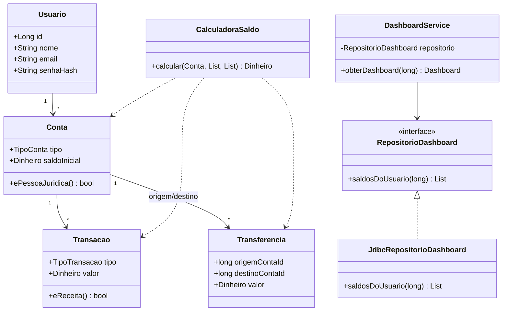

# MisterMoney API (Java / Spring Boot)

Backend da API do MisterMoney, integrado ao banco SQL Server criado no SSMS.

## Orientação a objeto

O código é organizado em quatro camadas, com dependências apontando para o domínio:

| Camada | Pacote | Responsabilidade |
| --- | --- | --- |
| Domínio | `domain.model`, `domain.valueobject`, `domain.service`, `domain.readmodel` | Entidades, value objects, regras de negócio e modelos de leitura. Não depende de Spring nem de JDBC. |
| Aplicação | `application.ports`, `application.service`, `application.dto`, `application.mapper` | Casos de uso e contratos (portas). Define *o que* precisa ser feito, não *como*. |
| Infraestrutura | `infrastructure.persistence`, `infrastructure.seed`, `infrastructure.config` | Adaptadores concretos: JDBC, carga inicial, CORS. Implementam as portas. |
| Interface | `interfaces.web` | Controller REST e tratamento de erros. Converte HTTP ↔ DTOs. |



Pontos de destaque:

- **Imutabilidade**: entidades e value objects têm campos `final`; não há setters.
- **Value objects**: `Dinheiro`, `Competencia` e os enums de tipo encapsulam validações que antes eram CHECK constraints do banco.
- **Serviço de domínio**: `CalculadoraSaldo` mantém em Java a regra de saldo que a view `v_saldo_contas` também implementa.
- **Inversão de dependência**: `DashboardService` conhece só a interface `RepositorioDashboard`; trocar JDBC por JPA/API externa não muda a aplicação.
- **DTOs separados**: o contrato HTTP (`DashboardResponse`) não expõe as entidades do domínio.

## Pré-requisitos

- JDK 17 ou superior
- Maven 3.9+
- SQL Server com o database `MisterMoney` (tabelas e views já criadas)

## Configuração

As variáveis de ambiente seguem `../.env.example`. A mais importante é `MSSQL_JDBC_URL`:

```powershell
$env:MSSQL_JDBC_URL = 'jdbc:sqlserver://localhost:1433;databaseName=MisterMoney;integratedSecurity=true;encrypt=false;trustServerCertificate=true'
```

Para autenticação NTLM (sem DLL nativa), use:

```
jdbc:sqlserver://HOST:1433;databaseName=MisterMoney;authenticationScheme=NTLM;user=DOMINIO\USUARIO;password=SENHA;encrypt=false;trustServerCertificate=true
```

## Executar

```powershell
cd BackEnd
mvn spring-boot:run
```

Na primeira execução com o banco vazio, o seed cria:

- usuário `samuel@mistermoney.local` / senha `123456` (hash BCRYPT gerado em runtime);
- contas Pessoal (CPF) e Empresa (CNPJ), categorias, transações, transferência, orçamentos e imposto DAS.

Para desativar o seed: `$env:MSSQL_SEED_ENABLED = 'false'`.

## Endpoint do dashboard

```
GET http://localhost:8081/api/dashboard/1
```

Retorna `saldos`, `resumoMensal`, `receitaAnual` e `orcamentos`, lidos diretamente das views do banco.

## Testes

```powershell
mvn test
```
